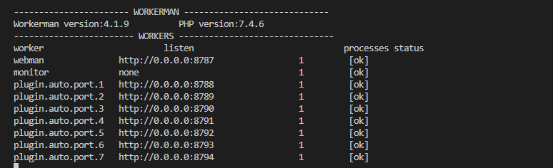
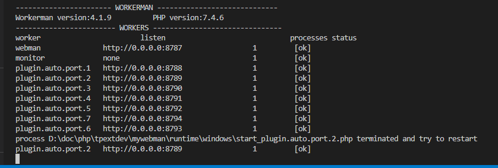

## 简介

自动创建多个`process`对应多个端口，可使用`apache`或`nginx`等做负载均衡。

实现原理：https://www.workerman.net/doc/webman/others/task.html

- `windows` 下webman不支持多进程，使用此插件帮你自动创建多个`process + port`，配合nginx、apache等环境增加并发能力。
相关问题

https://www.workerman.net/q/10247 、https://www.workerman.net/q/10238

- `linux` 系统也可以用使用

## 安装

`composer require ichynul/auto-process`

## 使用

在配置文件`config/plugin/auto/port/app.php`中调整`process_count`数量。

例如`8`，那将会自动创建`7`不同的端口.

### nginx 代理设置

和官方配置一样：
https://www.workerman.net/doc/webman/others/nginx-proxy.html

在`upstream webman`添加多个server-port

```nginx
upstream webman {
    server 127.0.0.1:8787;
	server 127.0.0.1:8788;
	server 127.0.0.1:8789;
	server 127.0.0.1:8790;
	server 127.0.0.1:8791;
	server 127.0.0.1:8792;
	server 127.0.0.1:8793;
	server 127.0.0.1:8794;
	#...更多
    keepalive 10240;
}
server {
	#...
}
```

### Windows上使用nssm生成网站服务，开机自启，崩溃自启

https://www.workerman.net/a/1422

## 效果图(可选)

启动后：

任务管理器显示：

杀死进程模拟程序异常终止：


## LICENSE

MIT
